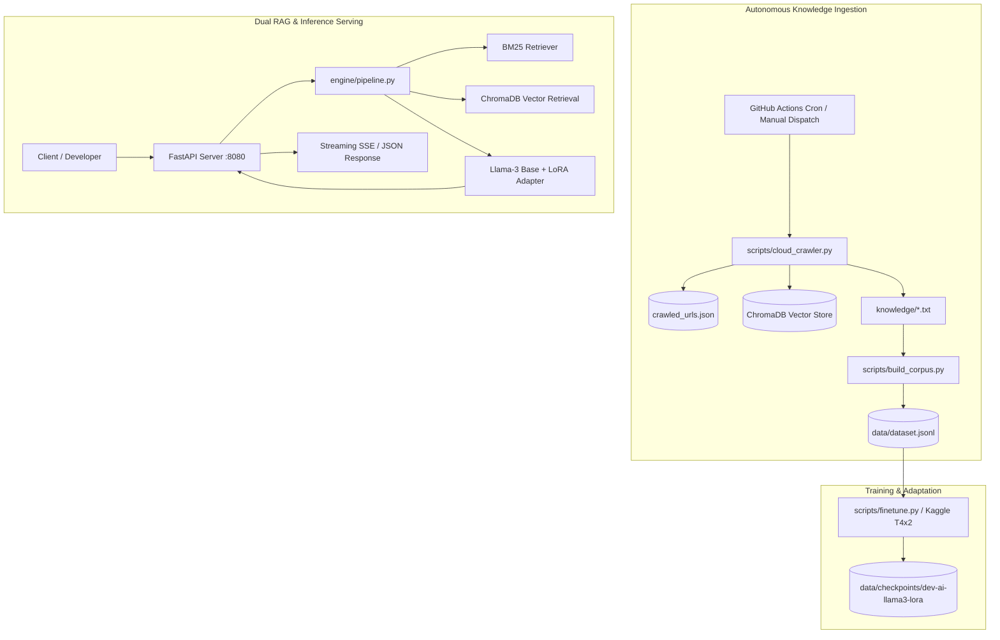

# DevAI 🚀

**DevAI** is an autonomous, domain-specialized developer AI assistant and inference engine. Powered by a fine-tuned **Llama-3 8B** backbone (via 4-bit QLoRA), DevAI features a dual-layer Retrieval-Augmented Generation (RAG) system, persistent vector memory, and an autonomous continuous web crawler that continually expands its knowledge base.

---

## ✨ Features

- **Domain-Specialized Foundation Model**: Fine-tuned on instruction datasets spanning Operating Systems, DBMS/SQL, Computer Networks, Python, Java, Mobile (Android/iOS), Desktop (Windows/macOS), Cloud, and cutting-edge tech.
- **QLoRA 4-bit Fine-Tuning**: Built on `unsloth/llama-3-8b-Instruct-bnb-4bit` for memory-efficient training with LoRA adapters, runnable on dual T4 GPUs (e.g. Kaggle) or consumer-grade hardware.
- **Dual-Layer RAG Engine**:
  - **Lexical BM25 Retriever**: Rapid keyword and domain matching against structured topic modules.
  - **ChromaDB Semantic Vector Memory**: Real-time semantic similarity search over crawled world knowledge and technical documentation.
- **Autonomous Continuous Learning**:
  - GitHub Actions cron workflow (`.github/workflows/crawler.yml`) runs every 6 hours.
  - Autonomous web crawling via DuckDuckGo and targeted documentation sources.
  - Automatic URL deduplication, vector embedding generation, and Git-backed knowledge sync.
- **Production-Ready FastAPI Server**:
  - Full request/response and Server-Sent Events (SSE) streaming endpoints.
  - Built-in metrics, topic classification, and retriever telemetry.

---

## 🏗 Architecture Overview



---

## 📁 Repository Structure

```plaintext
dev_ai/
├── .github/
│   └── workflows/
│       └── crawler.yml          # 6-hour autonomous crawler GitHub Action
├── config.yaml                  # Model, training, tokenizer, and server configuration
├── kaggle_train.ipynb           # Ready-to-run Kaggle QLoRA training notebook
├── requirements.txt             # Project dependencies
├── engine/
│   ├── __init__.py
│   ├── pipeline.py              # HuggingFace pipeline loader + LoRA merging
│   ├── retriever.py             # Lexical BM25 chunk retriever
│   └── server.py                # FastAPI HTTP server with streaming support
├── scripts/
│   ├── agent_tools.py           # ChromaDB search and agent utilities
│   ├── build_corpus.py          # Converts knowledge files to Llama-3 instruction JSONL
│   ├── cloud_crawler.py         # Autonomous web crawler with ChromaDB ingestion
│   ├── expand_knowledge.py      # Script to download extended documentation & repos
│   ├── finetune.py              # QLoRA fine-tuning script with SFTTrainer & PEFT
│   └── retrieve.py              # CLI & library interface for ChromaDB RAG
├── knowledge/                   # Domain-specific text modules
│   ├── python.txt
│   ├── java.txt
│   ├── fullstack.txt
│   ├── android.txt
│   ├── ios.txt
│   ├── windows.txt
│   ├── mac.txt
│   ├── os.txt
│   ├── networks.txt
│   ├── dbms.txt
│   ├── sql.txt
│   ├── sqlite.txt
│   └── ...                      # Continuously updated knowledge files
└── data/                        # Datasets, checkpoints, and vector databases (git-managed / local)
```

---

## 🚀 Getting Started

### 1. Prerequisites

- Python 3.10 or higher
- Git & Git LFS (if tracking large model weights)
- Recommended: CUDA-enabled GPU (NVIDIA 16GB+ VRAM) or Apple Silicon (M1/M2/M3 with MPS support)

### 2. Installation

Clone the repository and install the required dependencies:

```bash
git clone https://github.com/Subid-Kant/dev_ai.git
cd dev_ai

# Create virtual environment
python3 -m venv venv
source venv/bin/activate  # On Windows: venv\Scripts\activate

# Install dependencies
pip install -r requirements.txt
```

---

## 🛠 Usage & Workflow

### 1. Knowledge Base Expansion & Dataset Preparation

Expand the knowledge base from online sources or re-index existing files into instruction tuning format:

```bash
# Expand domain content
python scripts/expand_knowledge.py

# Run the cloud crawler locally to update ChromaDB and knowledge text
python scripts/cloud_crawler.py

# Compile raw knowledge into instruction dataset (data/dataset.jsonl)
python scripts/build_corpus.py
```

### 2. Training & Fine-Tuning

#### Option A: Local / Server Fine-Tuning
Run the QLoRA training script using PEFT and TRL:

```bash
python scripts/finetune.py
```

#### Option B: Kaggle T4 x2 GPU
Use [`kaggle_train.ipynb`](kaggle_train.ipynb):
1. Package the repository into a zip archive and upload as a Kaggle dataset.
2. Select **GPU T4 x2** accelerator with **Internet Enabled**.
3. Run the notebook to generate the instruction dataset and train the LoRA adapter.
4. Export the resulting weights (`data/checkpoints/dev-ai-llama3-lora`).

### 3. Launching the API Server

Start the FastAPI inference server:

```bash
uvicorn engine.server:app --host 0.0.0.0 --port 8080 --reload
```

Interactive API documentation will be available at:
- Swagger UI: `http://localhost:8080/docs`
- ReDoc: `http://localhost:8080/redoc`

---

## 📡 API Reference

### Health Check
```http
GET /health
```
```json
{
  "status": "ready",
  "model_loaded": true,
  "model_path": "data/checkpoints/dev-ai-llama3-lora",
  "device": "cuda:0",
  "kb_chunks": 420
}
```

### Query Endpoint
```http
POST /query
Content-Type: application/json

{
  "query": "How do goroutines achieve lightweight concurrency compared to OS threads?",
  "topic": "os",
  "max_tokens": 512,
  "temperature": 0.7
}
```

### Streaming Query (SSE)
```http
POST /query/stream
Content-Type: application/json

{
  "query": "Write a Python decorator that measures function execution time.",
  "topic": "python"
}
```

---

## 🔄 Autonomous Knowledge Crawler

The project includes an autonomous crawler powered by GitHub Actions ([`.github/workflows/crawler.yml`](.github/workflows/crawler.yml)):

- **Schedule**: Executes automatically every 6 hours (`0 */6 * * *`) or manually via workflow dispatch.
- **Workflow**:
  1. Executes `scripts/cloud_crawler.py`.
  2. Queries search indexes for latest tech breakthroughs and domain documentation.
  3. Deduplicates against `data/crawled_urls.json`.
  4. Stores embeddings directly in `data/chroma_db/`.
  5. Automatically commits and pushes new knowledge back to the repository.

---

## ⚙️ Configuration

Key hyperparameters and file paths are centralized in [`config.yaml`](config.yaml):

```yaml
model:
  vocab_size: 32000
  context_length: 2048
  embed_dim: 1024
  ffn_dim: 2816

training:
  batch_size: 1
  gradient_accumulation: 4
  learning_rate: 3.0e-4
  mixed_precision: true

inference:
  temperature: 0.7
  top_p: 0.9
  retrieval_top_k: 5
```

---

## 📄 License

This project is licensed under the MIT License. See [LICENSE](LICENSE) for details if applicable.
